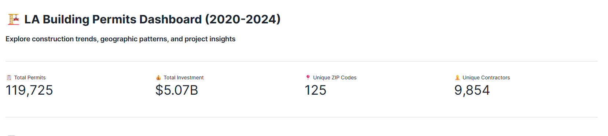
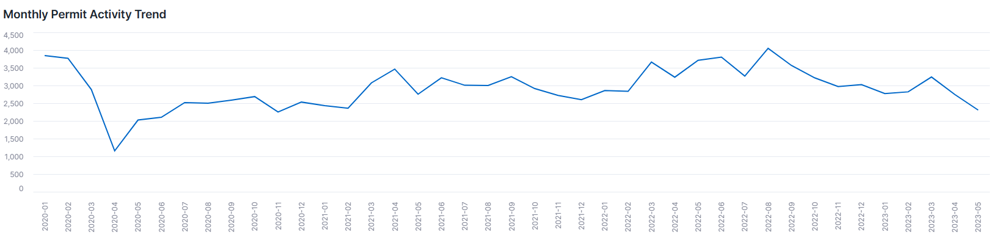
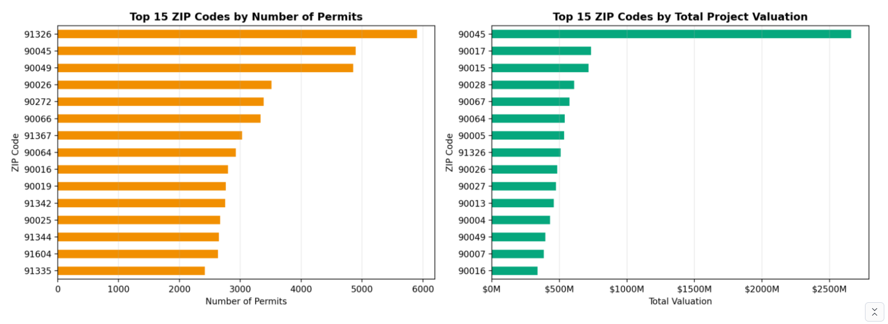
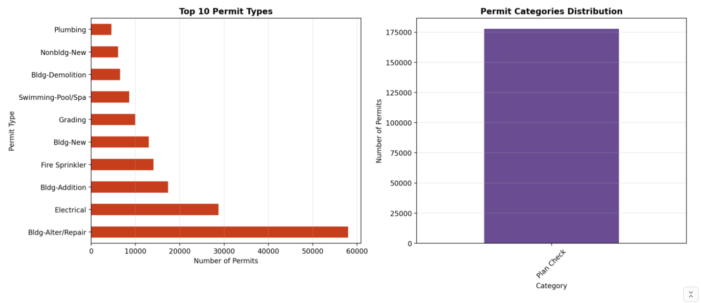
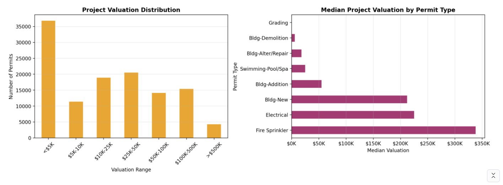
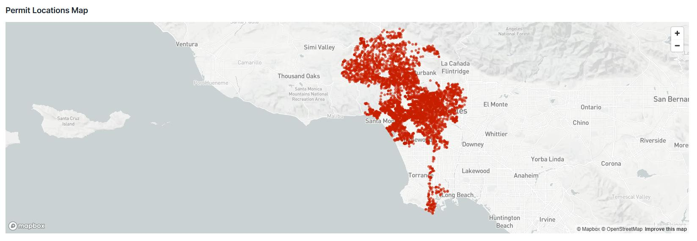

# LA Building Permits Analysis: Where Construction Activity and Investment Concentrate (2020 – May 2023)

**Solo project** · Business analytics course project · Snowflake, Python, Streamlit

I analyzed 177,704 Los Angeles building permits issued between January 2020 and May 2023, representing $22.93B in project valuation, to answer one question: where are the city's construction activity and investment concentrated, what kind of work makes them up, and who does the work? I also built an interactive Streamlit in Snowflake dashboard that lets a user explore the same questions with filters.

The short answer: most permits are for modest work on existing buildings (the median project is $20,000 and a third of permits are alterations or repairs), the areas with the most permits are not the areas with the most dollars, and contractor activity is distributed across many license numbers.



*Dashboard header, shown in its default filtered view. The default filter hides the highest-valuation permits, so these cards show 119,725 permits and $5.07B rather than the full-data totals of 177,704 permits and $22.93B. The dashboard title says 2020-2024; the data ends on May 19, 2023.*

## Business Question

Where is Los Angeles's construction activity and investment concentrated, what kind of work accounts for it, and who does the work?

Permit counts and permit dollars can tell different stories, so the analysis looks at both throughout.

## Data

- **177,704 building permits** issued from January 2, 2020 to May 19, 2023, with a total valuation of **$22.93B**.
- **2023 is a partial year.** It covers January through May 19 only.
- Permit records were joined to a contractor license table to attach business names to license numbers.
- The data was queried in Snowflake through a Snowpark session and analyzed in Python.
- The data is not included in this repository. It lived in a course Snowflake database (`LA_PERMIT_DATA`).

## Approach

Data preparation was limited to what the questions needed:

- parsing the issue and status dates
- converting valuation from text (with `$` and commas) to a number
- filtering to permits issued in 2020 or later
- grouping valuations into bands, from under $5K to over $500K
- excluding zero valuations and the top 1% of valuations when computing the summary statistics in Analysis 4
- joining permits to the contractor license table

The analysis then follows a chain of five questions: **when → where → what → how much → who**. Each analysis answers a question raised by the one before it. Everything here is descriptive: it shows how permits and valuation are distributed, not why.

## The Five Analyses

1. **When:** how did permit volume and total valuation change from year to year?
2. **Where:** which ZIP codes have the most permits, and which have the most valuation?
3. **What:** which types of work account for the permits?
4. **How much:** how large are projects, and how is valuation distributed across them?
5. **Who:** which contractors hold the most permits, and how concentrated is the work?

## Findings

### 1. Permit volume and valuation both grew from 2020 to 2022

| Year | Permits | Total valuation |
|---|---|---|
| 2020 | 46,208 | $6.67B |
| 2021 | 52,089 | $6.36B |
| 2022 | 58,774 | $7.84B |
| 2023 (Jan – May 19 only) | 20,633 | $2.05B |

Between 2020 and 2022, permits rose 27% and total valuation rose 18%. The lower 2023 figures reflect a partial year, not a decline.



*Monthly permits issued, from the dashboard's default filtered view (counts are lower than the full data). The line ends in May 2023 because the data does.*

### 2. The areas with the most permits are not the areas with the most investment

The 15 most active ZIP codes account for over a quarter of permit activity. ZIP 91326 (Porter Ranch) has the most permits, at 5,902. ZIP 90045 (Westchester) has the highest total valuation, at about $2.66B, which is several times that of any other ZIP code. Ranking areas by permit count and ranking them by dollars produces two different lists.



### 3. Most permits are for work on existing buildings, not new construction

| Permit type | Permits | Share of all permits |
|---|---|---|
| Building alteration/repair | 57,956 | 33% |
| Electrical | 28,740 | 16% |
| Fire sprinkler | 14,052 | 8% |
| New building | 12,994 | 7% |

Alterations and repairs alone are a third of all permits. New buildings are 7%.



*The right-hand panel has a single bar because every permit in this dataset falls under one category, Plan Check.*

### 4. The typical project is small, and a few large ones carry a disproportionate share of the dollars

The median project valuation is $20,000. The mean is $181,944, pulled far above the median by a small number of very large projects. There are 36,835 permits under $5K and 4,302 over $500K. Those largest permits are 2.4% of the total. The valuation distribution is highly skewed: a small share of high-value permits contributes disproportionately to total valuation.



### 5. Contractor activity is distributed across many license numbers

The permits list 12,968 unique license numbers. Solar and energy installers are among the most active contractors: Tesla Energy Operations (2,580 permits) and Sunrun (1,237) are among the highest-volume named contractors.

41,507 permits (23.4%) carry license number 0, which stands for missing or no contractor information. That placeholder is included in the 12,968, so the count should not be read as exactly 12,968 identified contractors, and nearly a quarter of permits cannot be tied to a contractor. This is a data-quality limit on any contractor-level conclusion.

## Dashboard

I built the dashboard with Streamlit in Snowflake. It is not publicly hosted, because it runs against the course Snowflake database. The code is in the final cell of the notebook and in `streamlit_app.py`.

What it does:

- **Sidebar filters:** years, permit type, ZIP code and a valuation range slider, with summary metrics for the filtered data
- **Four KPI cards:** total permits, total investment, unique ZIP codes and unique contractors
- **A section for each of the five analyses,** with bar and line charts and tables
- **Monthly permit trend**
- **Permit location map** (up to 5,000 points)
- **Data explorer** showing the first 1,000 filtered rows, with a CSV download of the filtered data
- **Key-insights footer**



*Permit location map from the dashboard, in its default filtered view. It plots up to 5,000 permits, not all of them.*

## Implications

- **Permit volume in this period mostly reflects work on existing buildings.** Alterations and repairs are a third of permits and new buildings are 7%, so a rising permit count is a signal of renovation activity more than of new development.
- **Volume and value are different maps.** The areas with the most permits are not the areas with the most investment, so construction activity needs to be read in counts and in dollars separately.
- **Averages misrepresent this market.** The typical project is small (median $20,000), while a small share of high-value permits carries a disproportionate share of the dollars.
- **Contractor activity is distributed across many license numbers.** About 13,000 appear in the data, but 41,507 permits (23.4%) use license number 0, so the distinct-license count should not be read as exactly 12,968 identified contractors.
- **Data quality limits some conclusions.** Missing contractor information and the partial 2023 year both constrain what can be said.

## Limitations

- 2023 covers only January through May 19, so year-over-year comparisons involving 2023 are not like-for-like. The dashboard's "Change from 2020 to 2023" figure and its "2023 data suggests market changes" note are artifacts of this partial year.
- Dashboard screenshots show the default filtered view (valuations from $0 to the 95th percentile, which also drops permits with no valuation), so their totals differ from the full-data figures.
- 41,507 permits (23.4%) have license number 0, meaning no contractor is listed. The data does not say why.
- Neighborhood names come from a ZIP-code lookup, not from the dataset.
- The analysis is descriptive, not causal.
- Re-running it requires access to the course Snowflake database (`LA_PERMIT_DATA`), which is not included.
- The notebook was saved without outputs. The results shown here come from the outputs captured in the submitted write-up.
- The summary statistics in Analysis 4 exclude zero valuations and the top 1% of valuations.

## Repository Contents

```text
LA-Permit-Data-Analysis/
├── README.md
├── streamlit_app.py
├── environment.yml
├── notebooks/
│   └── la_permit_analysis.ipynb
├── docs/
│   └── project_writeup.pdf
└── images/
```

- `notebooks/la_permit_analysis.ipynb`: the Snowflake Notebook with data preparation, the five analyses, summary statistics and the dashboard code. It also contains a few exploratory setup cells that the final analyses do not use. It was saved without outputs.
- `streamlit_app.py`: the dashboard code, copied unchanged from the notebook's final cell.
- `docs/project_writeup.pdf`: the original submitted write-up, kept unchanged. Its title says 2020–2024, but the data runs from January 2020 to May 2023. Where a figure in the write-up's text differs from this README, the README follows the outputs captured in the write-up.
- `environment.yml`: the Snowflake Notebook package file.
- `images/`: charts and dashboard screenshots taken from the write-up.

## Tools

Snowflake (Snowpark), Python, pandas, NumPy, Matplotlib, Streamlit (in Snowflake)
